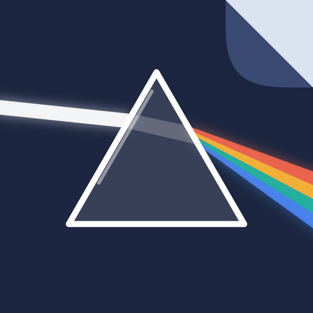
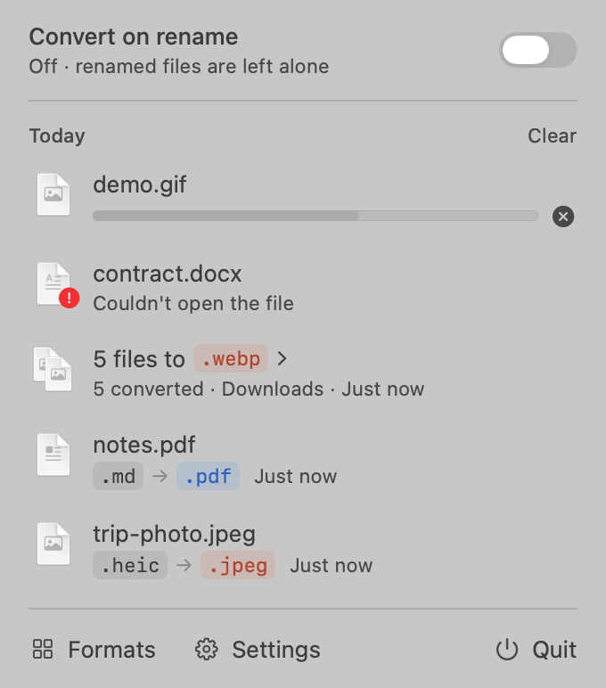

<p align="center">
  
</p>

<h1 align="center">Convert Anything</h1>

<p align="center">
  <b>Convert any file on your Mac by renaming it.</b><br>
  Change <code>notes.md</code> to <code>notes.pdf</code>, <code>photo.heic</code> to <code>photo.jpg</code>
  or <code>song.wav</code> to <code>song.mp3</code>, and it's converted in place.
</p>

<p align="center">
  <a href="../../releases/latest"></a>
  
  
  <a href="LICENSE"></a>
</p>

<p align="center">
  <a href="../../releases/latest"><b>⬇&nbsp; Download for macOS</b></a>
</p>

<!-- HERO DEMO: replace docs/placeholders/demo.svg with docs/demo.gif (or paste a GitHub video URL on its own line). -->
<p align="center">
  
</p>

## Features

- **Just rename.** No windows, no export dialogs. Change the extension in Finder and you're done.
- **Lives in the menu bar.** Watches the folders you choose (Desktop, Documents and Downloads by default).
- **Private.** Everything runs on your Mac: no uploads, no accounts.
- **Undo by renaming back.** Change the extension back to get the original.
- **Many files at once.** Select them, right-click → Rename, and replace the extension.
- **History by day.** Recent conversions in the menu, colour-coded by kind of file.
- **Updates itself** with [Sparkle](https://sparkle-project.org).

<p align="center">
  
</p>

## Supported formats

| Kind | Formats |
|---|---|
| **Images** | PNG, JPEG, HEIC, TIFF, GIF, BMP, WebP, AVIF, ICO |
| **Documents** | PDF, Markdown (with LaTeX math), TXT, HTML, Word (.docx/.doc), RTF, ODT, Pages, PowerPoint (.pptx/.ppt), Keynote |
| **Spreadsheets** | Excel (.xlsx/.xls), CSV, Numbers |
| **Audio** | MP3, WAV, M4A, AAC, FLAC, Ogg, Opus, AIFF |
| **Video** | MP4, MOV, M4V, and video → GIF |

Click **Formats** at the bottom of the menu to see every conversion.

<!-- FORMATS SCREENSHOT: replace docs/placeholders/formats.svg with docs/formats.png -->
<p align="center">
  
</p>

## Install

1. Download `Convert-Anything.zip` from the [latest release](../../releases/latest) and unzip it.
2. Drag **Convert Anything** into your Applications folder.
3. Open it. The first time, macOS blocks it because it isn't from the App Store:
   click **Done**, then open **System Settings → Privacy & Security**, scroll down and click
   **Open Anyway** next to "Convert Anything was blocked". You only do this once.

<details>
<summary>No "Open Anyway" button?</summary>

Paste this into Terminal:

```bash
xattr -dr com.apple.quarantine "/Applications/Convert Anything.app"
```
</details>

Requires macOS 14 (Sonoma) or later, on Apple Silicon or Intel.

## Usage

1. Click the prism icon in the menu bar. Add or remove watched folders under **Settings**.
2. In a watched folder, rename a file to the extension you want, for example `report.docx` → `report.pdf`.
3. The converted file appears in place and shows up in the menu's history.

<!-- BATCH DEMO: replace docs/placeholders/batch.svg with docs/batch.gif -->
<p align="center">
  
</p>

Allow notifications when asked, and turn on **Open at login** if you want it always running.

## FAQ

**Do my files leave my Mac?**
No. Conversions use macOS's own frameworks plus two small bundled libraries. Nothing is uploaded.

**Do I need Microsoft Office?**
No. Keynote, Pages and Numbers (free from Apple) are optional: they give the best results for
PowerPoint → PDF and Word → PDF, and Numbers is needed for Excel → PDF. The first time the app uses
one, macOS asks for permission to control it: click **OK**.

**How do updates work?**
About once a day the app checks this repository's latest release and offers to install it.
Turn that off, or check now, under **Settings → Updates**.

<!-- SETTINGS SCREENSHOT: replace docs/placeholders/settings.svg with docs/settings.png -->
<p align="center">
  
</p>

## How it works

Most conversions use macOS's own frameworks: ImageIO, PDFKit, AVFoundation, WebKit, Vision (text
recognition) and Quick Look. Two small libraries are built into the app: LAME for MP3 and libwebp for
WebP. Word, PowerPoint and spreadsheet files are read and written directly; Keynote, Pages and Numbers
are scripted when they're installed and give a better result.

## Build from source

Requirements: Xcode 26 or later, Homebrew on an Apple Silicon Mac, and Rosetta
(`softwareupdate --install-rosetta`) to build the Intel half of the libraries.

```bash
git clone https://github.com/JayBirdZhang/convert-anything.git
cd convert-anything
./Scripts/build-dependencies.sh     # builds LAME and libwebp into ThirdParty/ (about a minute)
open "Convert Anything.xcodeproj"
```

In Xcode, choose your own team under *Signing & Capabilities* (and, if you like, your own bundle
identifier), then build and run. `ThirdParty/` is not checked in; the script makes it from the
official source releases, fetched and checksum-verified by Homebrew.

<details>
<summary>Making a release</summary>

Bump `MARKETING_VERSION` and `CURRENT_PROJECT_VERSION`, then run `./Scripts/make-release.sh notes.html`.
It builds the universal app and writes `build/release/Convert-Anything.zip` and a signed
`appcast.xml`; attach both to a GitHub release tagged `v<version>`. Signing needs the Sparkle key in
the maintainer's keychain (`generate_keys --account convert-anything`).
</details>

## License

Copyright (C) 2026 JayBirdZhang.

Convert Anything is free software: you can redistribute it and/or modify it under the terms of the
[GNU General Public License](LICENSE) as published by the Free Software Foundation, either version 3
of the License, or (at your option) any later version. It is distributed in the hope that it will be
useful, but WITHOUT ANY WARRANTY; without even the implied warranty of MERCHANTABILITY or FITNESS FOR
A PARTICULAR PURPOSE. See the GNU General Public License for more details.

In short: you may use, change and share it, even for money, but anything you distribute that is
based on it must also be released under the GPL with its full source code.

The bundled libraries keep their own licenses (LAME: LGPL 2; libwebp: BSD 3-Clause; Sparkle: MIT); see
[ThirdPartyNotices.txt](Convert%20Anything/ThirdPartyNotices.txt). The name "Convert Anything" and
the app icon are not covered by the license.
